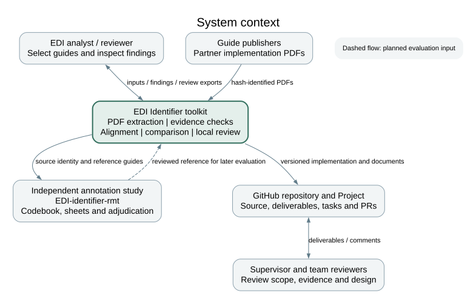
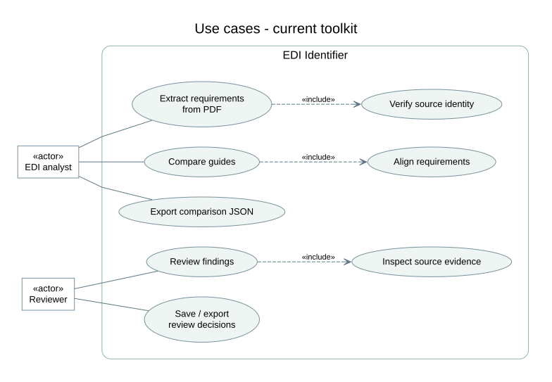
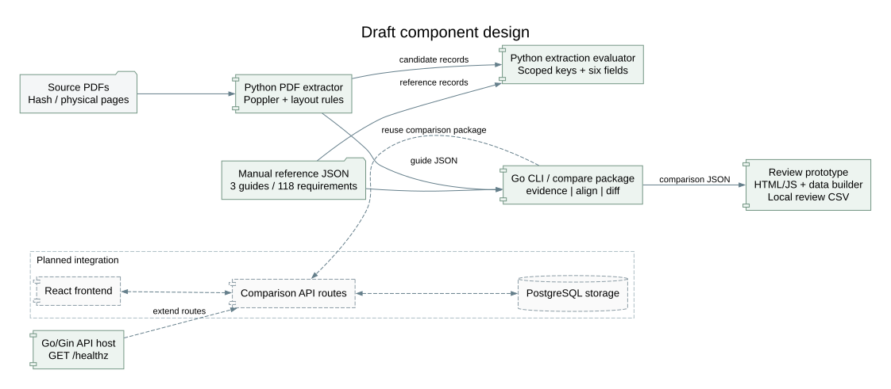

# 7 Architecture and diagrams

The toolkit separates PDF extraction, structural alignment, constraint comparison and review. This reflects the distinction between structural and constraint-based matching [S10] and allows errors to be attributed to the stage that produced them.

## Implemented workflow

1. A guide's metadata identifies the source PDF by URL, SHA-256 and physical page count.
2. The Python extractor runs Poppler and selects one of two layout parsers. It writes guide-schema JSON with page excerpts and review flags.
3. The Go edi CLI verifies evidence, aligns keys and compares usage, codes, repetition and conditions. It writes JSON findings and separate unmatched-key lists.
4. The prototype data builder invokes edi diff for the manual reference guides. It creates a browser bundle with source records and automated findings.
5. The local interface filters those findings, displays evidence and exports separate review decisions.
6. The extraction evaluator compares candidate records with the manually normalized reference within its declared segment/position scope.

The Go/Gin API currently exposes GET /healthz. PostgreSQL appears in Compose, but the API does not yet use it. Comparison API routes, shared persistence and the React application are planned.

## Contracts and boundaries

The guide schema represents loop path, segment, position, element and qualifier, together with usage, repetition, codes, conditions, evidence and optional review reasons. The Go Report/Finding types define comparison JSON. A finding is a judgment about one property of an aligned pair; a requirement without a counterpart is listed separately.

The browser bundle includes a content digest and stable finding order for the same inputs. Its F-prefixed IDs and machine verdicts belong to the toolkit workflow. The research project's U-prefixed sheets support independent annotation and cannot be replaced by a prototype export.

Future service routes must preserve these identities and evidence fields. Shared storage must add revision and reviewer identity, while maintaining access separation for independent coding.

## Architectural risks

Schema validity cannot establish semantic correctness. Layout rules can miss content, qualifier-assisted alignment can join different scopes and source URLs can change. Hashes, visible alignment rules, review states and an independently adjudicated reference address different parts of this risk.

## System context

The analyst supplies comparable guides and reviews findings. Public guide providers supply PDFs. The repository and tracker hold source data, deliverables and review history. Independent annotation is maintained in the separate EDI-identifier-rmt research project; its sheets have their own IDs and protocol.

## Use cases

The UML use-case view covers the implemented toolkit. Actor associations are undirected; include arrows point from a use case to required supporting behavior. Extracting a PDF includes source verification; comparing guides includes structural alignment. Recording/exporting review decisions is a separate goal from exporting automatic comparison results.

## Draft component design

Solid components and flows represent implemented behavior. Dashed components and flows represent the proposed service integration. The comparison package remains reusable through the CLI and the later API.

