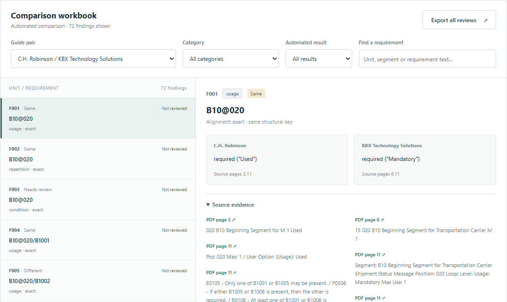
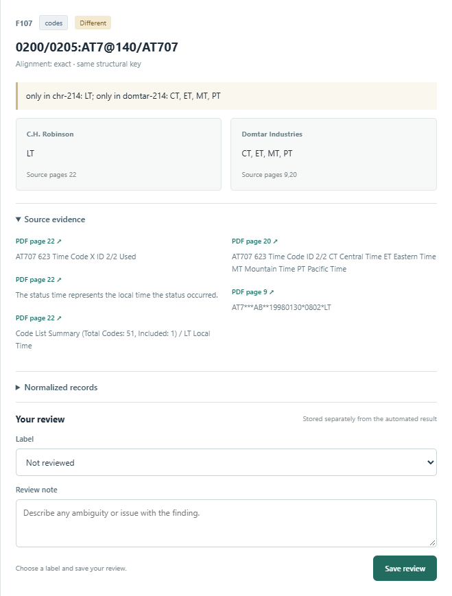

# 8 UX and prototype

The review prototype presents findings produced by the Go comparison CLI for the three manually normalized reference guides. PDF extraction is available through the separate Python command. The browser reads a generated dataset and stores review decisions locally.

## Key scenarios

1. **Select context.** Choose a guide pair, filter by category or automated verdict, and search by finding ID, key or text. The initial CHR-KBX pair contains 72 findings.
2. **Inspect a finding.** Compare both values, the alignment rule, the automated verdict and its explanation. Expand source evidence and normalized records; source links open the published PDF at the cited page.
3. **Review the result.** Save a same, different or unknown decision with a note. The decision is stored separately from the automated verdict. Reloading restores saved reviews for the same dataset.
4. **Inspect unmatched requirements.** Expand the pair's unmatched list and follow its page links. Absence of an aligned counterpart is recorded separately from a property stated in only one guide.
5. **Export reviews.** CSV export includes all 188 findings with their original values, machine verdicts, keys and page references. Only the review label and note reflect local edits.

The controls have text labels, keyboard focus indicators, empty states and a message when browser storage is unavailable. The layout is checked at desktop and mobile widths. Login, shared storage, PDF upload and comparison API integration are planned components.

## Reproduction and checks

Open [the prototype](../prototype/index.html) directly in a browser. [The demonstration](../DEMO.md) gives the CLI and extraction commands. The data builder compiles or uses an existing edi executable, invokes its JSON comparison report and generates the browser dataset. It retains a content digest so saved reviews are separated when inputs or findings change.

Browser checks exercise pair/category/result/search filters, evidence links, local persistence, immutable machine verdicts, empty filters, storage failure and mobile page width. A separate CSV check verifies every immutable field and quoted multiline notes. [The verification record](../evidence/verification.md) records these checks.

The independent annotation study uses the separate research repository and its own codebook and sheet format. Prototype review exports are intended for inspecting toolkit findings.

