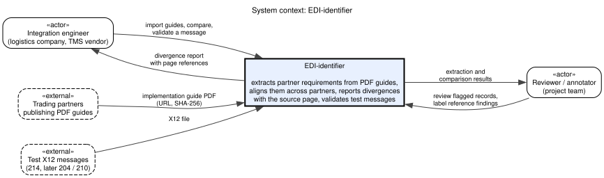
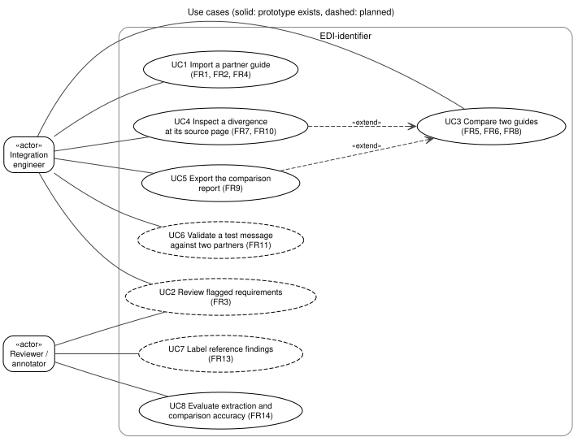
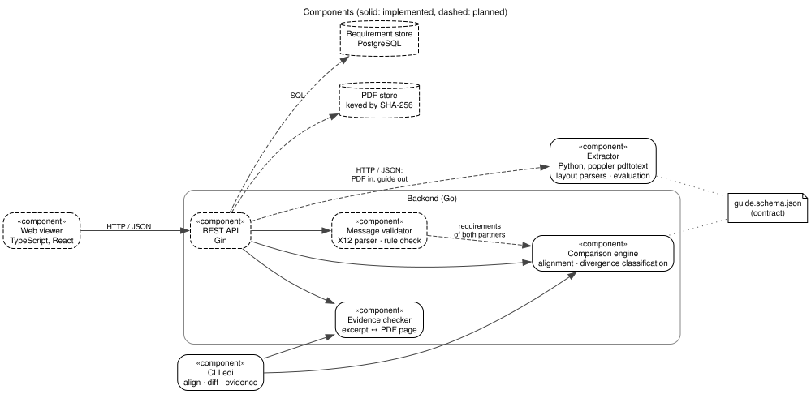
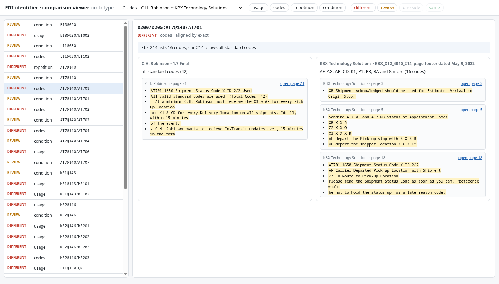

# EDI-identifier: pre-defense 1 report

**Development of a Toolkit for Automated Comparison of ANSI X12 EDI Implementation Guides with an Investigation into Partner-Specific Implementation Divergence in Freight Logistics**

Astana IT University, School of Software Engineering, group SE-2405. Diploma project, team of three.
Supervisor: Elvira Aitmukhanbetova, senior lecturer.
Repository: https://github.com/nurashi/EDI-identifier, tag `pre-defense-1`.

## 1. Project proposal

### Problem

Freight companies exchange shipment data through ANSI X12 EDI. The standard defines each message, for example the 214 shipment status, as a set of segments and elements with usage designators, code lists and syntax rules. Every large shipper, carrier and 3PL then publishes its own implementation guide: a PDF that narrows, extends or overrides the standard for that partner. Two messages that are both valid X12 214 can therefore be rejected by one partner and accepted by another.

When a company connects a new trading partner, or a partner releases a new guide revision, an integration engineer reads the PDF and compares it by hand with the guides already supported. The PDFs differ in layout and wording, the same requirement can appear as a usage flag in one guide and only as a sentence in a note in another, and one segment can be defined several times at the same position for different qualifiers. Differences are easy to miss, and a missed difference surfaces later as a rejected message or a lost status update.

Existing validators check one message against one specification. They do not compare the specifications of different partners with each other, and they do not show where in the source document a requirement comes from.

### Target users

- Integration engineers and EDI analysts at shippers, carriers, 3PLs and TMS vendors who onboard trading partners.
- Developers of transportation management systems who maintain partner-specific EDI mappings.
- Researchers studying how a shared standard is implemented differently by its users.

### Aim

Build a toolkit that extracts the requirements of X12 implementation guides from their PDFs into one machine-readable model, aligns the requirements of different partners, and reports every divergence together with the page of each source document, and evaluate how accurately it does so.

### Objectives

1. Select comparable public guides and define a requirement model in which every value is linked to its page and excerpt.
2. Extract requirements from guide PDFs of different layouts into that model and flag what cannot be extracted reliably.
3. Align requirements across partners by segment, position, loop, element and qualifier, and classify divergences in usage, code lists, repetition and conditions.
4. Provide a REST API and a web viewer that shows two guides side by side with the source page of each divergence, and validate a test message against two partners' rules.
5. Build a reference set and measure the accuracy of extraction and comparison on guides not used during development.

### Expected outcomes

- A working toolkit: guide import, normalized requirement store, divergence report with page references, side-by-side viewer, validation of test messages.
- A public corpus of normalized guides for X12 214/004010 with verified page evidence.
- An evaluation of extraction and comparison accuracy (precision, recall, F1 per category) on held-out guides.

### Scope

Table: Scope of the project

| In scope | Out of scope |
|---|---|
| X12 214 (shipment status), release 004010, truckload; 204 and 210 as extensions | EDIFACT, XML and API-based exchange |
| Public PDF guides of shippers, carriers and 3PLs | Guides that are not available as text PDFs (scans need OCR) |
| Transaction-set content: segments, elements, usage, codes, repetition, conditions | Envelope segments (ISA, GS, GE, IEA) and transport protocols (AS2, SFTP) |
| Validation of a test message against two partners' requirements | Translation or mapping of production messages |

### Engineering complexity

The guides follow no common layout, and the same requirement is written as a table value in one guide and as prose in another. One segment can have several definitions at one position, split by qualifier codes, so matching by segment name is wrong. Code lists can be given as an explicit list, as "all standard codes" or by reference to another element. Every extracted and compared value has to stay traceable to its page so that an engineer can check it. The prototype already covers these cases on three guides (Sections 7–9).

## 2. Evidence of relevance

### What the evidence must show

The requirements in Section 6 rest on four assumptions. Each is listed with the evidence that supports it so far and its status.

Table: Assumptions behind the requirements and their evidence

| ID | Assumption | Evidence | Status |
|---|---|---|---|
| A1 | Guides for the same message differ materially between partners | Analysis of three public 214 guides (below) | Verified on three guides |
| A2 | Engineers compare guides by hand when onboarding a partner, and it takes significant time | User discussions (P1, P2) | Supported: manual comparison, 3–8 hours per specification, a new partner or guide update every one to four weeks |
| A3 | Engineers need the source page to trust a reported difference | User discussions (P1, P2) | Supported: both would not trust a difference without the page |
| A4 | A report of differences would be used in onboarding and guide updates | User discussions (P1, P2) | Supported: both want a web view with export to a spreadsheet |

### Analysis of available data

The pilot corpus contains three public truckload 214/004010 guides: C.H. Robinson (32 pages), KBX (30 pages) and Domtar (23 pages). Their 118 requirements were normalized by hand and every value was checked against its page in CI. Comparing them with the prototype (`edi diff`) gives the following counts of aligned requirement pairs.

Table: Differing requirement pairs in the pilot corpus

| Guide pair | Usage | Code list | Repetition | Only in one guide |
|---|---|---|---|---|
| C.H. Robinson ~ KBX | 14 of 34 | 8 of 10 | 1 of 7 | 11 + 9 |
| C.H. Robinson ~ Domtar | 5 of 7 | 7 of 7 | 2 of 6 | 18 + 3 |
| KBX ~ Domtar | 6 of 8 | 7 of 7 | 2 of 8 | 13 + 0 |

Each cell gives the pairs that differ out of the pairs where both guides state the property. Pairs where only one guide states it, and repetition of definitions split by qualifier, are left out of the counts and reported separately by the tool.

Examples: C.H. Robinson allows all 42 standard shipment status codes in AT701, KBX allows 16; C.H. Robinson and KBX allow only the time code `LT` in AT707, Domtar only `CT`, `ET`, `MT` and `PT`; C.H. Robinson allows the status loop once per message, KBX up to ten times. In each case a mapping built for one partner sends values the other rejects. The data supports A1 for these three partners; whether the same holds across the industry is checked on further guides in Section 9.

### Discussions with user representatives

Three to five integration engineers and EDI analysts outside the team are interviewed with five questions: how often they onboard partners or receive guide updates, how they compare guides today and how long it takes, which differences occur and which caused failures, whether the source page matters, and which form of tool they would use. Participants are anonymous; the record keeps role, company type and experience.

Table: Discussions with user representatives

| ID | Participant | Findings | Linked requirements |
|---|---|---|---|
| P1 | EDI integration engineer, transportation software company; written answers | A new partner or broker integration every month, updates of existing specifications every quarter. Compares a new guide by hand with a similar partner, 3–5 hours per specification. Language models help with basic fields but invent code lists, confuse loops and miss the difference between optional and conditional, so both PDFs are still checked by eye. Most failures come from conditional dependencies and closed code lists: in one case a broker required a reason code in AT702 for status X6 only when another element was filled; the condition was in a footnote on page 18, and messages were silently rejected in staging until it was found. Will not trust a reported difference without the page. Wants a web interface and an export to a spreadsheet to attach the differences to a development task; the report must show code-list differences, loop repeat limits, and syntax notes and conditional dependencies | FR6, FR7, FR9, FR10, FR16 |
| P2 | EDI integration engineer, transportation software company; video call | A new partner every one to two weeks; large shippers release updates, including version changes and new qualifier rules, without a change log. Reads the PDF in full and compares it by hand with a template; the first audit and mapping matrix take 4–8 hours. Language models invent qualifiers from the base standard that the guide does not allow and move elements between loops, so both PDFs are checked line by line. Failures come from date and time formats, hidden mandatory qualifiers and repeat limits: a retailer required AT7 date and time in the local time of the delivery point, the team sent UTC, statuses arrived "from the future" and the customer's ERP quarantined them for two days until the footnote on page 23 was found. Will not trust a difference without the exact page and item. Wants a side-by-side view like a Git diff with export to a spreadsheet; the report must show "mandatory at A, optional at B", allowed qualifier codes, and a link to the exact place in the PDF | FR4, FR6, FR7, FR9, FR10, FR17 |

### What the discussions changed

- The export of the report to a spreadsheet becomes a Must (FR9), because the differences are attached to development tasks; it was implemented the same day (`edi diff -csv`, DIP-23).
- Conditional dependencies caused the most failures, while the prototype only flags them for review; comparing them becomes a separate Must requirement (FR16, DIP-24).
- Partners publish new revisions, including version changes and new qualifier rules, without a change log (P2); comparing two revisions of one partner's guide becomes a requirement (FR17).
- P2's production failure, arrival statuses sent in UTC while the partner required local time in AT7, explained in a footnote on page 23 of its guide, is the kind of difference the tool already reports for AT707 between Domtar and the other two guides (Section 2, analysis of available data).
- Manual comparison at 3–5 hours (P1) and 4–8 hours (P2) per specification becomes the time baseline of the evaluation (Section 9).
- Both engineers tried language models on guide excerpts and report invented code lists and qualifiers, confused loop hierarchy and optional mixed up with conditional; this supports the choice of deterministic structural comparison (Section 5.5).

## 3. Literature review

### Search and selection

Sources were searched in Crossref, Google Scholar and publisher libraries for five themes: divergence in the implementation of standards, B2B message interoperability, extraction of structured content from PDF, comparison of machine-readable interface specifications, and schema matching. A source was kept if it is peer reviewed or a widely used open-source system description, if it addresses one of the themes directly, if its metadata could be confirmed at the publisher, and if its full text can be read free of charge. Fifteen sources are used: fourteen peer-reviewed publications and one preprint; twelve are from 2021–2026, the rest are foundational. Every reference was checked against Crossref or PubMed, and every full text was opened; where the publisher's copy is paywalled, the reference gives the free copy (author, institutional or arXiv version).

### Partner-specific divergence from a shared standard

Conformance to one standard does not guarantee compatibility between its users. Coiera (2023) describes this as "the standard problem": in an open system no single definitive standard can persist, because contexts, implementations and versions drift, and interoperability then depends on fitting work between local variants. The most direct quantitative evidence comes from health care rather than freight: Kramer (2022) analysed about 3,000 FHIR profiles from 125 implementation guides and found heavy, inconsistent profiling of the same resources, and Rosenau et al. (2024) found systematic discrepancies when data from 20 hospitals were validated against stricter shared profiles. Our search found no comparable study of freight EDI guides.

These works establish that partner-level variants of one standard are normal and costly, but they describe the phenomenon or measure it on machine-readable profiles. None measures how partners' X12 guides, published as PDFs, differ requirement by requirement. This project takes the framing from Coiera and the profile-analysis method from Kramer, and applies them to X12 214 guides with page-level evidence.

### B2B message interoperability

Earlier B2B research tried to remove the need to compare specifications. Vujasinovic et al. (2010) mediate between incompatible message sets through an ontological metamodel and annotated schemas, demonstrated on EDIFACT and OAGIS interfaces. Shin et al. (2009) test whether one application interprets message content as intended. Both assume machine-readable schemas and manual semantic annotation, and both act on one implementation or at run time. They do not help an engineer who receives two PDF guides and needs to know where they differ before writing a mapping. The project borrows the distinction between syntactic and semantic requirements from this work: usage, codes and repetition are compared mechanically, prose conditions are routed to a person.

### Extracting structured content from PDF

General document understanding has moved to learned models. PubTables-1M and the Table Transformer (Smock et al., 2022) detect tables and their structure, and Docling (Livathinos et al., 2025) combines layout analysis and table models into an open-source converter. A benchmark of ten extraction tools (Meuschke et al., 2023) shows that tables remain the weakest element even for the best tools, with lists and footers also problematic, and its documents are academic papers, not specifications. Large language models extend information extraction to free text (Xu et al., 2024), but their output is not deterministic and is not tied to a page by construction.

For implementation guides two properties matter more than generality: the values must be exact (a code list with one wrong code is wrong), and every value must be traceable to its page. Many guides, including all three in the pilot corpus, are generated by EDI authoring tools, so their tables keep a regular text layout. The project therefore parses the text layer with layout-specific rules, verifies every excerpt against its page, and flags prose instead of interpreting it. Learned table models and language models are kept as candidates for layouts the rules cannot read, with their output checked against the page in the same way.

### Comparing specifications and detecting violations

The closest software-engineering work concerns machine-readable API descriptions. RESTRuler (Bogner et al., 2024) finds design-rule violations in OpenAPI files with 91% precision and 68% recall; APIstic (Serbout & Pautasso, 2024a) computes metrics for over a million OpenAPI specifications; and a study of 3,075 APIs (Serbout & Pautasso, 2024b) classifies hundreds of thousands of changes between versions as breaking or not. Bogner et al. (2023) show experimentally that rule violations make interfaces harder to understand. This line of work demonstrates that specifications can be checked and diffed automatically at scale, but it compares one specification with generic rules or with its own earlier version, never two parallel specifications of different organisations, and it starts from machine-readable files. The project applies the same idea, a typed model plus explicit difference rules, to parallel partner guides.

### Aligning requirements

Aligning the requirements of two guides is a case of schema matching. Rahm and Bernstein (2001) distinguish element-level from structure-level and linguistic from constraint-based matching; recent work combines small and large language models to match tabular schemas (Liu et al., 2025). X12 offers a strong constraint that general schemas lack: segment identifier, position, loop and element number are defined by the standard. The project therefore aligns by these keys and uses the qualifier code sets to align definitions that a guide splits by qualifier, a constraint-based, structure-level matcher in Rahm and Bernstein's terms. Linguistic matching is needed only where a guide renames or restructures loops, which has not occurred in the pilot corpus.

### Analysis table

Table: Analysis of the reviewed publications

| # | Source | Type, year | Theme | Approach | Main finding | Limitation for this project |
|---|---|---|---|---|---|---|
| 1 | Coiera (2023) | Journal, 2023 | Divergence | Conceptual framework | No single persistent standard in open systems; conformance needs fitting | Health informatics, no measurement |
| 2 | Kramer (2022) | Conference, 2022 | Divergence | Analysis of ~3,000 FHIR profiles | Profiling of the same resources is heavy and inconsistent | Machine-readable profiles, counts not pairwise comparison |
| 3 | Vujasinovic et al. (2010) | Journal, 2010 | B2B interoperability | Ontological message metamodel | Semantic mediation between incompatible message sets | Needs schemas and manual annotation |
| 4 | Shin et al. (2009) | Journal, 2009 | B2B interoperability | Test procedure | Efficient content-level equivalence testing | Tests one implementation |
| 5 | Rosenau et al. (2024) | Journal, 2024 | Interoperability | Validation pipeline, 20 hospitals | Systematic discrepancies against shared profiles | Instance data, not specifications |
| 6 | Smock et al. (2022) | Conference, 2022 | PDF extraction | Dataset, transformer detection | Strong table detection and structure recognition | Scientific tables, no EDI semantics |
| 7 | Livathinos et al. (2025) | Preprint, 2025 | PDF extraction | Open-source conversion toolkit | Layout and table models on commodity hardware | Generic output, needs domain mapping |
| 8 | Meuschke et al. (2023) | Conference, 2023 | PDF extraction | Benchmark of 10 tools | Tables are the weakest element for all tools | Academic documents |
| 9 | Xu et al. (2024) | Journal, 2024 | PDF extraction | Survey of LLM extraction | Generative extraction across subtasks | Plain text, no page traceability |
| 10 | Bogner et al. (2024) | Conference, 2024 | Specification checking | Static analysis of OpenAPI | 91% precision, 68% recall on rule violations | One spec against generic rules |
| 11 | Serbout & Pautasso (2024a) | Conference, 2024 | Specification checking | Metrics for 1.27M OpenAPI files | Large-scale comparison of API designs | No element-level alignment |
| 12 | Serbout & Pautasso (2024b) | Conference, 2024 | Specification diffing | Mining 3,075 API histories | Breaking changes often violate versioning | Versions over time, not parallel partners |
| 13 | Bogner et al. (2023) | Journal, 2023 | Specification quality | Controlled experiment, 105 participants | Rule violations reduce understandability | Indirect |
| 14 | Rahm & Bernstein (2001) | Journal, 2001 | Matching | Taxonomy | Element/structure, linguistic/constraint matchers | Generic, pre-LLM |
| 15 | Liu et al. (2025) | Journal, 2025 | Matching | Small + large language models | Accurate scalable schema matching | Tabular schemas, untested on EDI |

### Gap

Work on standards explains why partner variants exist, health-informatics studies measure them on machine-readable profiles, PDF extraction research reads tables without domain semantics, and specification diffing compares versions of one machine-readable file. No published work extracts the requirements of different partners' X12 guides from their PDFs, aligns them and reports the differences with page evidence, and no study measures how much freight partners' guides for one message differ. The project addresses both: the toolkit (Sections 6–8) and its evaluation on held-out guides (Section 9).

## 4. Existing system comparison

Five systems were compared: three EDI guide tools that model partner guides, one free specification editor, and a generic PDF comparison as the baseline an engineer could use today. Claims are taken only from the vendors' documentation, listed under the table; "not documented" means the documentation does not say.

Table: Comparison of existing systems

| Criterion | Stedi Guides | GEFEG.FX | TIBCO Foresight EDISIM Comparator | EdiNation / Spec Builder | Adobe Acrobat Compare | EDI-identifier |
|---|---|---|---|---|---|---|
| C1 Machine-readable model of a partner guide | Yes [ST2, ST5] | Yes [GF1] | Yes [TB1] | Yes, OpenEDI [EN3] | No | Yes |
| C2 Reads partner guides from PDF | No, built in an editor or imported [ST2, ST3] | Not documented | No, paper guides are entered by hand [TB1] | No, OpenEDI or SEF [EN2] | Reads PDF as text | Yes, two layouts |
| C3 Compares two partners' guides | Not documented | Yes, guide comparison [GF2] | Yes [TB1] | Not documented | Text of two PDFs [AD2] | Yes |
| C4 Reports usage and code-list differences | Not documented | Not documented | Yes [TB1] | Not documented | No | Yes |
| C5 Reports repetition and syntax-rule differences | Not documented | Not documented | Repetition yes, syntax rules no [TB1] | Not documented | No | Repetition yes, conditions flagged |
| C6 Links each difference to the source page | Not documented | Not documented | No, guides are entered by hand [TB1] | Not documented | Yes, visually [AD2] | Yes |
| C7 Validates a message against a partner guide | Yes [ST1, ST4] | Yes [GF1] | Yes, Analyzer [TB2] | Yes [EN1] | No | Planned |
| C8 Free for academic use | Free sandbox [ST6] | No [GF1] | No | Yes [EN5] | No | Yes, open source |

TIBCO Foresight EDISIM Comparator is the closest system: its documentation describes checking a new partner's guideline against those of existing partners and reports requirement, code and repetition differences. It requires the guide to be entered by hand in its editor first and does not compare syntax rules. Stedi and EdiNation turn a guide into a machine-readable specification for validation but document no comparison between partners. GEFEG.FX compares guides modelled in it. Acrobat shows any textual change with its page, but it compares two versions of one document; on two different partners' guides almost every line differs, so the structural differences are lost in layout noise. None of the systems combines reading the PDF, structural comparison and page evidence, which is the combination the toolkit provides. Altova MapForce was also reviewed; it maps and validates EDI but documents no guide comparison, so it is not in the table.

Sources:

- [ST1] stedi.com/docs/edi-platform/guides/what-is-a-stedi-guide
- [ST2] stedi.com/docs/edi-platform/guides/customize-guides
- [ST3] stedi.com/docs/edi-platform/guides/import-guides
- [ST4] stedi.com/docs/edi-platform/guides/public-guides
- [ST5] stedi.com/changelog/schemas-for-reading-or-writing
- [ST6] stedi.com/pricing
- [GF1] gefeg.com/en/gefeg-fx
- [GF2] gefeg.com/en/news/2024/06/now-also-develop-json-schema-guides-with-gefeg-fx-gefeg-fx-2024-q2
- [TB1] docs.tibco.com, TIBCO Foresight EDISIM 6.21.0 Comparator User's Guide (2021)
- [TB2] docs.tibco.com, Introduction to TIBCO Foresight EDISIM (Instream 9.3.0)
- [EN1] edifabric.com/edination.html
- [EN2] edifabric.com/docs/edination/create-and-import-edi-specs.html
- [EN3] edifabric.com/openedi
- [EN5] edifabric.com/pricing.html
- [AD2] adobe.com/acrobat/how-to/compare-two-pdf-files.html

## 5. Technology comparison

Each decision lists the options considered, the criteria taken from the requirements in Section 6, and the choice.

### 5.1 Reading text from PDF guides

Table: Options for reading text from PDF guides

| Criterion | poppler `pdftotext -layout` | pdfplumber | PyMuPDF | Learned layout models (Table Transformer, LayoutLMv3) |
|---|---|---|---|---|
| Keeps table columns of the guide | Yes, as aligned text | Yes, with character coordinates | Yes, with block coordinates | Detects tables and cells |
| Deterministic output for one PDF | Yes | Yes | Yes | Depends on model version |
| Same text layer as the evidence check (NFR1) | Yes | No | No | No |
| Dependencies | One system package | Python package | Python package with native library | Model weights, GPU preferred |
| Explains its own result | Yes | Yes | Yes | Partly |

Choice: `pdftotext -layout` for the prototype. The two guide layouts in the corpus are generated by EDI authoring tools and keep their columns in the text layer, and using the same text as the evidence check means every extracted excerpt can be verified against its page. pdfplumber is the planned fallback for layouts whose columns do not survive as text, because it exposes character coordinates without a learned model.

### 5.2 Backend platform

Table: Backend platform options

| Criterion | Go + Gin | Python + FastAPI | Java + Spring Boot |
|---|---|---|---|
| Deployment | Single static binary, small image | Interpreter and packages | JVM and packages |
| Performance of in-memory comparison | High | Moderate | High |
| Team experience | Strong (Go in production) | Strong | Moderate |
| Fit with the extractor | Separate process | Same language as the extractor | Separate process |

Choice: Go with Gin. The comparison engine and validator are CPU-bound code over in-memory requirement sets, the result ships as one binary, and the team member responsible for the backend uses Go daily. Python stays where its libraries matter, in extraction.

### 5.3 Requirement storage

Table: Requirement storage options

| Criterion | PostgreSQL (relational + JSONB) | MongoDB | JSON files in Git |
|---|---|---|---|
| Versions of a guide and their history | Relational tables | Documents | Commits |
| Query across partners by key | SQL with indexes | Aggregation pipeline | Load everything |
| Integrity of guide, version and requirement links | Foreign keys | Application code | None |
| Fit for the prototype stage | Higher setup cost | Higher setup cost | Simplest, reviewable in PRs |

Choice: JSON files in Git for the corpus during development, because every change is reviewed and diffed; PostgreSQL for the toolkit, with guides and versions as tables and requirements in JSONB validated by the same schema.

### 5.4 Interaction between extractor and backend

Table: Options for interaction between extractor and backend

| Criterion | HTTP with JSON | Subprocess call to a CLI | Message queue |
|---|---|---|---|
| Independent deployment of Python and Go parts | Yes | No | Yes |
| Long PDFs without blocking a request | Needs a timeout or a job | Blocks | Yes |
| Operational cost | Low | Lowest | A broker to run |
| Contract | `guide.schema.json` | Same | Same |

Choice: HTTP with JSON. The extractor already works as a CLI that writes schema-valid JSON; wrapping it in a small HTTP service keeps the Python and Go parts deployable separately. A guide of 30 pages is extracted in about 0.1 s, so a queue is not needed now.

### 5.5 Comparison method

Table: Comparison method options

| Criterion | Structural alignment by X12 key | Text similarity of requirement descriptions | Large language model comparison |
|---|---|---|---|
| Uses the structure the standard defines | Yes | No | Partly |
| Same result on every run | Yes | Yes | No |
| Each result traceable to both pages | Yes | Yes | Hard to guarantee |
| Handles prose-only requirements | No, flags them | Partly | Yes |

Choice: structural alignment by segment, position, loop, element and qualifier, with a rule per category. The user discussions confirm the risk of the third option: an engineer who tried a language model on guide excerpts reported invented code lists, confused loops and optional mixed up with conditional (Section 2). Prose that the rules cannot judge is flagged for review instead of guessed; a language model may later propose labels for such items, but only as suggestions checked against the source page.

### 5.6 Web viewer

Table: Web viewer options

| Criterion | React + TypeScript | Server-rendered Go templates | Vue |
|---|---|---|---|
| Side-by-side view with filters and a PDF page panel | Component libraries and PDF.js | Possible, more manual | Component libraries and PDF.js |
| Team experience | Yes | Yes | Limited |
| Typed contract with the API | TypeScript types from the schema | Go types | TypeScript |

Choice: React with TypeScript.

## 6. Requirements specification

Priorities use MoSCoW. Status: done, prototype (works on the pilot corpus), planned.

### Functional requirements

Table: Functional requirements

| ID | Requirement | Priority | Acceptance criterion | Status |
|---|---|---|---|---|
| FR1 | Extract a guide PDF of a supported layout into the requirement schema, with page and excerpt for every value | Must | On the pilot guides all structured fields equal the hand-normalized reference; every excerpt is found on its cited page | Prototype |
| FR2 | Flag text the extractor does not classify | Must | Every requirement with unclassified notes carries a review flag; the count is reported | Prototype |
| FR3 | Let a reviewer confirm or correct extracted requirements, saved as a new guide version | Should | A corrected value is stored with reviewer and time; the previous version stays readable | Planned |
| FR4 | Store guides with partner, transaction set, X12 version, revision, source URL and SHA-256 | Must | Importing the same PDF twice creates no new version; a new revision does | Planned (fields exist in the schema) |
| FR5 | Align the requirements of two guides by segment, position, loop, element and qualifier | Must | Definitions split by qualifier align with an undivided definition when their codes intersect; unit tests pass | Done |
| FR6 | Classify each aligned pair in usage, codes, repetition and conditions as same, different, stated by one side, or needs review | Must | The known cases of the pilot corpus give the expected verdicts in tests | Done |
| FR7 | Show both source pages and excerpts for every finding | Must | No finding without pages on both sides | Done |
| FR8 | List requirements defined in one guide only | Must | Matches the alignment result | Done |
| FR9 | Export the comparison report as JSON and CSV | Must | JSON validates against a report schema; CSV opens in a spreadsheet | Done |
| FR10 | Web viewer: two guides side by side, filters by category and verdict, source page panel | Must | A user opens the page of any finding in one action from the list | Prototype |
| FR11 | Validate a test X12 214 message against the requirements of two partners | Should | Seeded violations in test messages are reported with the partner and rule | Planned |
| FR12 | REST API for import, comparison and validation | Must | Endpoints documented with OpenAPI; integration tests in CI | Planned |
| FR13 | Record reference labels for findings | Must | Labels stored per finding and reviewer; used by the evaluation | Planned |
| FR14 | Evaluate extraction and comparison against reference data | Must | Command reports recall, precision and field accuracy per guide | Extraction done |
| FR15 | Support transaction sets 204 and 210 | Could | One guide of each extracted and compared | Planned |
| FR16 | Compare syntax notes and conditional dependencies between partners, not only flag them | Must | Syntax rules and conditions written in a structured form ("if X then Y") are aligned and compared; the rest stays flagged with both texts | Planned (syntax rules extracted) |
| FR17 | Compare two revisions of one partner's guide and list what changed | Should | Two revisions of one guide give a report of changed, added and removed requirements, labelled with both revision dates | Works with the current comparison; revision history with FR4 |

### Non-functional requirements

Table: Non-functional requirements

| ID | Requirement | Acceptance criterion | Status |
|---|---|---|---|
| NFR1 | Traceability: every stored or reported value cites a page and excerpt | Evidence check finds 100% of excerpts on their pages in CI | Met on the pilot corpus |
| NFR2 | Reproducibility: the same PDF gives the same output | CI downloads the PDFs, checks SHA-256 and reruns extraction and comparison on every change | Met |
| NFR3 | Performance | A 30-page guide is extracted in under 10 s and two guides compared in under 1 s on a CI runner | Met: about 0.1 s and 5 ms |
| NFR4 | Extraction accuracy on unseen guides | Field accuracy at least 0.90 on held-out guides of supported layouts | To be measured |
| NFR5 | Usability | An engineer finds a given divergence and its source page within three actions, checked with 3–5 users | To be measured |
| NFR6 | Confidentiality: guides uploaded by a company stay in its deployment | No external service is called during extraction or comparison; no secrets in the repository | Met by design |
| NFR7 | Deployability | `docker compose up` starts the stack | Backend and database |
| NFR8 | Maintainability | New layouts are added as separate parsers; every module has tests in CI | Met |

## 7. Architecture and diagrams

### Overview

The toolkit is a pipeline around one contract, `schema/guide.schema.json`. A guide is identified by partner, transaction set, X12 version and the SHA-256 of its PDF. Each requirement has a structural key (segment, position, loop path, element, qualifier codes), usage as printed and as normalized, maximum use and loop repeat, code set, conditions, and a list of evidence entries with page and excerpt.

1. The **extractor** (Python) reads the PDF text layer, recognises the layout, and writes requirements with evidence. Notes it cannot classify are flagged.
2. The **evidence checker** (Go) confirms that every excerpt occurs on its cited page.
3. The **comparison engine** (Go) aligns two guides and classifies divergences.
4. The **REST API** (Go, Gin) exposes import, comparison and validation and stores guides in PostgreSQL; PDFs are kept by hash.
5. The **web viewer** (React) shows the report next to the source pages.
6. The **message validator** (Go) checks a test message against two partners' requirements using the same engine.

The CLI `edi` uses the comparison engine and evidence checker directly and serves as the test harness; together with the viewer prototype (Section 8) it is the current user interface.

### System context



### Use cases



### Components



Diagram sources are in `docs/diagrams/*.dot` (Graphviz) and are exported to SVG.

### Alignment of use cases, requirements and components

Table: Alignment of use cases, requirements and components

| Use case | Requirements | Components | Data |
|---|---|---|---|
| UC1 Import a partner guide | FR1, FR2, FR4 | Extractor, evidence checker, REST API, stores | PDF, guide JSON |
| UC2 Review flagged requirements | FR3 | Web viewer, REST API, requirement store | Guide versions |
| UC3 Compare two guides | FR5, FR6, FR8, FR16, FR17 | Comparison engine, REST API, CLI | Two guide versions, report |
| UC4 Inspect a divergence at its source page | FR7, FR10 | Web viewer, PDF store | Finding with pages |
| UC5 Export the report | FR9 | REST API, CLI | Report JSON / CSV |
| UC6 Validate a test message | FR11 | Message validator, comparison engine | X12 file, two guides |
| UC7 Label reference findings | FR13 | Web viewer, requirement store | Labels |
| UC8 Evaluate accuracy | FR14 | Extractor evaluation, comparison engine | Reference guides and labels |

## 8. Prototype

The prototype consists of the command line with its input and output data, and a clickable viewer prototype on real data.

### Extract a guide from its PDF

```
$ python3 -m extractor extract pdfs/kbx-214.pdf --meta corpus/214-004010/guides/kbx-214.json -o kbx.json
$ python3 -m extractor evaluate kbx.json corpus/214-004010/guides/kbx-214.json
kbx-214: 43 of 43 reference requirements found, 43 extracted in the same segments
  recall 1.000, precision 1.000
  usage         43/43  1.000
  base          43/43  1.000
  max_use       43/43  1.000
  loop_repeat   43/43  1.000
  codes         43/43  1.000
  syntax        43/43  1.000
  free-text conditions in the reference, not extracted: 54; extracted records flagged for review: 24
```

One extracted requirement (the excerpt is shortened here):

```json
{
  "key": { "segment": "AT7", "position": "140", "loop": ["0200", "0205"], "element": "AT701" },
  "usage": { "declared": "conditional", "declared_label": "X" },
  "codes": { "mode": "enumerated", "values": ["AF", "AG", "AR", "CD", "K1", "P1", "PR", "RA", "RD", "RL", "XB", "X1", "X3", "X4", "X6", "ZZ"] },
  "evidence": [{ "page": 18, "excerpt": "AT701 1650 Shipment Status Code X ID 2/2 / AF Carrier Departed Pick-up Location with Shipment / AG Estimated Delivery / …", "supports": ["usage", "codes"] }],
  "review": { "reason": "1 free-text note(s) not classified" }
}
```

### Compare guides

```
$ edi diff corpus/214-004010/guides/*.json
            guide pair    category  same  different  one side  review
     chr-214 ~ kbx-214       usage    20         14         0       0
     chr-214 ~ kbx-214       codes     2          8         1       0
     chr-214 ~ kbx-214  repetition     6          1         0       1
     chr-214 ~ kbx-214   condition     0          0         8      11
...
chr-214 ~ kbx-214
  different codes 0200/0205:AT7@140/AT701
    chr-214 p.21: all standard codes (42)
    kbx-214 p.3,5,18: AF, AG, AR, CD, K1, P1, PR, RA and 8 more (16 codes)
    kbx-214 lists 16 codes, chr-214 allows all standard codes
  different repetition 0200/0205:AT7@140
    chr-214 p.3,20,21,22: max use 1; loop repeat 1
    kbx-214 p.6,18: max use 1; loop repeat 10
    loop repeat 1 vs 10
```

`edi diff -json report.json` writes the same findings for the API and the viewer, and `-csv report.csv` as a table to attach to a development task (added after user discussion P1); `edi evidence -pdfs DIR` checks every excerpt of a guide file against its PDF.

### Viewer prototype

A clickable prototype of the viewer, `prototype/viewer.html`, shows the key scenario on the real comparison of the three guides; it opens in any browser without a server. On the left are the findings of the chosen guide pair, filtered by category and verdict. On the right is the selected requirement in both guides with its classification and reason, and for each side the excerpts of every cited page with a link that opens that page of the partner's PDF (FR7, FR10, NFR5).



In the figure C.H. Robinson allows all 42 standard shipment status codes in AT701 (page 21), while KBX lists 16 (pages 3, 5 and 18). The prototype is generated from `edi diff -all -json` and the corpus by `prototype/build.py`. The React viewer (DIP-17) will add the rendered PDF page beside the excerpts and the reviewer's actions (FR3, FR13).

## 9. Verification and evaluation plan

### Testing

Table: Testing levels

| Level | What | Where |
|---|---|---|
| Unit | Key normalisation, alignment rules, each divergence rule, both layout parsers, evaluation counts | Go and Python tests, CI jobs `backend` and `extractor` |
| Data | Every corpus file validates against the schema; every excerpt is found on its page in the downloaded PDF with the recorded SHA-256 | CI jobs `schema` and `pilot` |
| End to end | The three guides are extracted from their PDFs, validated, checked for evidence, evaluated against the reference and compared | CI job `pilot` on every change |
| API and viewer | Endpoint integration tests; scripted viewer scenarios | Planned with FR10, FR12 |

### Metrics

Table: Evaluation metrics and targets

| Aim | Metric | Target |
|---|---|---|
| Extraction finds the requirements | Recall and precision of requirement keys against the reference | Recall at least 0.95 on supported layouts |
| Extraction reads them correctly | Accuracy per field: usage, maximum use, loop repeat, codes, syntax rules | At least 0.90 per field (NFR4) |
| Comparison finds the real differences | Precision, recall and F1 of `different` findings per category against reference labels | Reported per category; F1 at least 0.85 for usage and codes |
| The report is usable | Task success and time to locate a given divergence and its page | 3–5 engineers; within three actions (NFR5) |
| Validation catches partner-specific errors | Share of seeded violations in test messages reported with the right partner | At least 0.9 |

### Conditions

- Development guides (C.H. Robinson, KBX, Domtar) are kept separate from held-out guides: at least three further public 214/004010 guides, normalized by hand before the parser is run on them.
- Every PDF is fixed by SHA-256; runs happen in CI on a clean runner.
- Reference labels for comparison come from two reviewers labelling independently; disagreements are resolved before the evaluation.

### Baselines

- **Text diff:** `diff` of the `pdftotext` output of two guides, the closest thing to what a generic document comparison offers. Measured: how many reference divergences it surfaces and how much unrelated change it reports.
- **Manual comparison:** 3–5 hours (P1) and 4–8 hours (P2) per specification reported in the user discussions; measured again in the usability sessions.
- **Hand-normalized corpus:** the reference for extraction.

### Current results

On the three development guides the extractor finds 118 of 118 reference requirements, and every structured field (usage, base designator, maximum use, loop repeat, code set, syntax rules) equals the reference. 75 conditions written as free text in the guides are not classified and are flagged for review. These are development results: the parser was written against these guides, so they do not yet measure generalisation; that is what the held-out guides are for.

## 10. Project management and risks

### Repository and tracker

- Repository: https://github.com/nurashi/EDI-identifier. `main` is the reviewed baseline; work is done in branches and merged through pull requests reviewed by another team member; CI must pass.
- Tracker: YouTrack project DIP, https://edi-ide.youtrack.cloud/projects/DIP, with a Kanban board (Backlog, In Progress, Review, Done). Each task names the responsible student, expected outcome, acceptance criteria, deadline, priority, subsystem and target pre-defense, and links its commits and pull request. Branches are named after their task (`DIP-14-viewer-mockup`), commit titles end with the task ID, and pull requests list their tasks and how the work was checked.
- At submission of pre-defense 1 the project holds 22 tasks: DIP-1 to DIP-8 done (repository and CI, schema, pilot corpus, alignment, divergence classification, extraction prototype, diagrams, README), DIP-9 to DIP-15 for this stage (report, user discussions, supervisor feedback, review, corpus verification, viewer mockup, submission), and DIP-16 to DIP-22 planned for the next stages with proposed deadlines.

### Responsibilities

Table: Responsibilities of the team members

| Member | Responsibility (approved plan) |
|---|---|
| Nurassyl Orazbek | Requirement model, comparison engine, backend and REST API, evaluation |
| Asylan Usen | Guide selection, reference corpus and labelling, web viewer |
| Anuar Zhenissov | PDF extraction and normalization |

### Contributions to pre-defense 1

Table: Contributions to pre-defense 1

| Member | Contribution | Where to see it |
|---|---|---|
| Nurassyl Orazbek | Requirement schema, pilot corpus, alignment and divergence classification, extraction prototype, CI, diagrams, viewer prototype, report | Commits in `main`; DIP-1 to DIP-9, DIP-14 |
| Asylan Usen | Review of PR #1; check of PDF identity before extraction and UTF-8 handling in the extractor and the prototype | PR #1 review; PR #26, DIP-26 |
| Anuar Zhenissov | YouTrack project: fields, versions, board; machine-readable evaluation of the extractor in CI | YouTrack project DIP; PR #29, DIP-27 |

### Milestones

Table: Milestones

| Milestone | Content |
|---|---|
| Pre-defense 1 (`pre-defense-1`) | Analysis, design, plan; requirement model, pilot corpus, extraction and comparison prototypes |
| Pre-defense 2 (`pre-defense-2`), 50% of the work | REST API with storage, viewer for comparison and source pages, held-out corpus, first evaluation, all report chapters except results |
| Final pre-defense (`final-pre-defense`), complete system | Validation of test messages, 204 and 210, full evaluation, final report |

### Risks

Table: Risks and mitigation

| Risk | Likelihood | Impact | Mitigation |
|---|---|---|---|
| Unseen guides use layouts the parsers do not recognise | High | High | Parsers per layout family; pdfplumber fallback; unrecognised layouts reported instead of guessed; hand normalization for the reference |
| Prose requirements dominate some guides | Medium | Medium | Flag for review; measure how much is prose; optional suggestions checked against the page |
| Too few comparable public guides | Medium | High | Search carrier and shipper portals early; include 204 and 210 if 214 is too narrow |
| Reference labels are inconsistent | Medium | Medium | Written labelling rules, two independent reviewers, disagreement resolution before evaluation |
| Uneven availability of team members | Medium | High | Tasks with owners and deadlines on the board; weekly review of the board; work reassigned when a deadline is missed |
| Partner guides change during the project | Low | Low | Each guide is fixed by SHA-256 and revision date |

### Dependencies

- Public availability of partner guides (source URLs are recorded with hashes).
- Poppler on the build machine; Go and Python toolchains in CI.
- Supervisor feedback on the proposal and requirements (Section 11).
- Participants for user discussions and usability sessions.

## 11. Supervisor feedback

Table: Supervisor feedback and decisions

| Date | Deliverable reviewed | Comment | Decision |
|---|---|---|---|

## References

Bogner, J., Kotstein, S., Abajirov, D., Ernst, T., & Merkel, M. (2024). RESTRuler: Towards automatically identifying violations of RESTful design rules in web APIs. In *2024 IEEE 21st International Conference on Software Architecture (ICSA)* (pp. 123–134). IEEE. https://doi.org/10.1109/ICSA59870.2024.00020 Free full text: https://arxiv.org/abs/2402.13710

Bogner, J., Kotstein, S., & Pfaff, T. (2023). Do RESTful API design rules have an impact on the understandability of Web APIs? *Empirical Software Engineering, 28*(6), Article 132. https://doi.org/10.1007/s10664-023-10367-y

Coiera, E. (2023). The standard problem. *Journal of the American Medical Informatics Association, 30*(12), 2086–2097. https://doi.org/10.1093/jamia/ocad176 Free full text: https://arxiv.org/abs/2304.09114

Kramer, M. A. (2022). Reducing FHIR "profiliferation": A data-driven approach. *AMIA Annual Symposium Proceedings, 2022*, 634–643. https://pmc.ncbi.nlm.nih.gov/articles/PMC10148270/

Liu, Y., Pena, E. H. M., Santos, A., Wu, E., & Freire, J. (2025). Magneto: Combining small and large language models for schema matching. *Proceedings of the VLDB Endowment, 18*(8), 2681–2694. https://doi.org/10.14778/3742728.3742757 Free full text: https://arxiv.org/abs/2412.08194

Livathinos, N., Auer, C., Lysak, M., Nassar, A., Dolfi, M., Vagenas, P., Berrospi Ramis, C., Omenetti, M., Dinkla, K., Kim, Y., Gupta, S., Teixeira de Lima, R., Weber, V., Morin, L., Meijer, I., Kuropiatnyk, V., & Staar, P. W. J. (2025). *Docling: An efficient open-source toolkit for AI-driven document conversion* (arXiv:2501.17887). arXiv. https://doi.org/10.48550/arXiv.2501.17887

Meuschke, N., Jagdale, A., Spinde, T., Mitrović, J., & Gipp, B. (2023). A benchmark of PDF information extraction tools using a multi-task and multi-domain evaluation framework for academic documents. In *Information for a Better World: Normality, Virtuality, Physicality, Inclusivity* (Lecture Notes in Computer Science, Vol. 13972, pp. 383–405). Springer. https://doi.org/10.1007/978-3-031-28032-0_31 Free full text: https://arxiv.org/abs/2303.09957

Rahm, E., & Bernstein, P. A. (2001). A survey of approaches to automatic schema matching. *The VLDB Journal, 10*(4), 334–350. https://doi.org/10.1007/s007780100057 Free full text: https://nbn-resolving.org/urn:nbn:de:bsz:15-qucosa2-319685

Rosenau, L., Behrend, P., Wiedekopf, J., Gruendner, J., & Ingenerf, J. (2024). Uncovering harmonization potential in health care data through iterative refinement of Fast Healthcare Interoperability Resources profiles based on retrospective discrepancy analysis: Case study. *JMIR Medical Informatics, 12*, e57005. https://doi.org/10.2196/57005

Serbout, S., & Pautasso, C. (2024a). APIstic: A large collection of OpenAPI metrics. In *Proceedings of the 21st International Conference on Mining Software Repositories (MSR '24)* (pp. 265–277). ACM. https://doi.org/10.1145/3643991.3644932

Serbout, S., & Pautasso, C. (2024b). How many web APIs evolve following semantic versioning? In *Web Engineering: ICWE 2024* (Lecture Notes in Computer Science, Vol. 14629, pp. 344–359). Springer. https://doi.org/10.1007/978-3-031-62362-2_25 Free full text: https://design.inf.usi.ch/sites/default/files/biblio/apiace-icwe2024.pdf

Shin, J., Kim, J., & Ivezic, N. (2009). Application information mapping test: An efficient content-level semantic equivalence test procedure for B2B integration. *International Journal of Computer Integrated Manufacturing, 22*(10), 976–986. https://doi.org/10.1080/09511920903030361 Free full text: https://tsapps.nist.gov/publication/get_pdf.cfm?pub_id=902747

Smock, B., Pesala, R., & Abraham, R. (2022). PubTables-1M: Towards comprehensive table extraction from unstructured documents. In *2022 IEEE/CVF Conference on Computer Vision and Pattern Recognition (CVPR)* (pp. 4624–4632). IEEE. https://doi.org/10.1109/CVPR52688.2022.00459 Free full text: https://arxiv.org/abs/2110.00061

Vujasinovic, M., Ivezic, N., Barkmeyer, E., & Marjanovic, Z. (2010). Semantic B2B-integration using an ontological message metamodel. *Concurrent Engineering, 18*(3), 219–232. https://doi.org/10.1177/1063293X10379764 Free full text: https://tsapps.nist.gov/publication/get_pdf.cfm?pub_id=906036

Xu, D., Chen, W., Peng, W., Zhang, C., Xu, T., Zhao, X., Wu, X., Zheng, Y., Wang, Y., & Chen, E. (2024). Large language models for generative information extraction: A survey. *Frontiers of Computer Science, 18*(6), Article 186357. https://doi.org/10.1007/s11704-024-40555-y

Implementation guides of the pilot corpus: C.H. Robinson (2022), *Truckload carrier X12 214, version 1.7 Final*; KBX Technology Solutions (2023), *ASC X12 4010 214 Transportation Carrier Shipment Status Message*; Domtar Industries (2008), *Paper Transportation EDI Implementation Guidelines, 214*. Source URLs and SHA-256 hashes are recorded in `corpus/214-004010/guides/*.json`.

